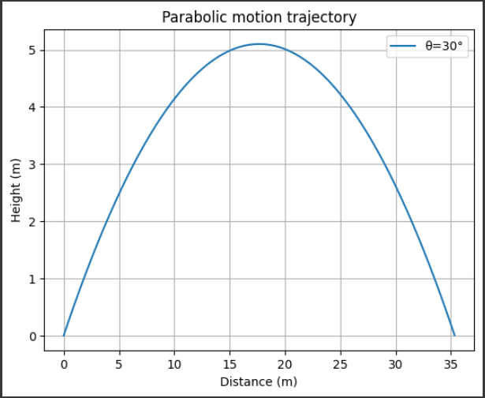
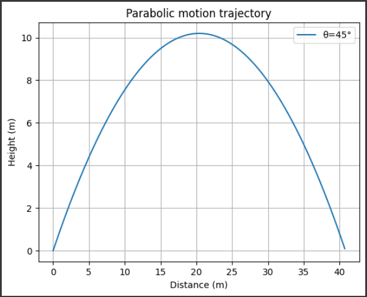

# 포물선 운동 분석 — 발사각에 따른 궤적

같은 초속도(20 m/s)로 발사각만 30°, 45°, 60°로 바꿔 포물선 궤적을 그려 비교했습니다.

- 언어/라이브러리: Python, NumPy, Matplotlib
- Claude AI는 github 정리에만 사용, 코드 작성에는 미사용함.

```
src/
  parabolic_motion_30deg.py
  parabolic_motion_45deg.py
  parabolic_motion_60deg.py
results/                     # 각도별 궤적 그래프
```

## 방법

- 비행 시간 `t_max = 2·v₀·sinθ / g` (g = 9.8 m/s²)
- 수평: `x = v₀·cosθ·t`, 수직: `y = v₀·sinθ·t − ½·g·t²`
- 0.01초 간격으로 위치를 계산해 그래프로 표시 (세 파일은 발사각만 다름)

## 결과

| 30° | 45° | 60° |
|---|---|---|
|  |  |  |

45°에서 수평 도달 거리가 가장 길고, 30°와 60°는 도달 거리가 같지만 60°가 더 높이 올라갑니다 (도달 거리 `R = v₀²·sin2θ / g`).

## 실행 방법

```bash
pip install -r requirements.txt
python src/parabolic_motion_45deg.py
```
